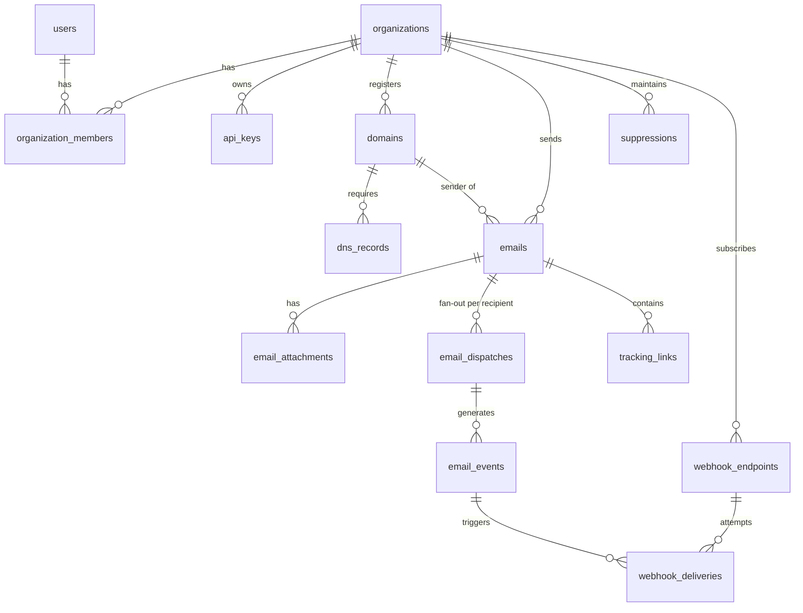

# POSTIVO — Product Requirements Document (PRD)

**Versi:** 3.0.0 (Development-Ready)
**Status:** Disetujui untuk implementasi — perubahan wajib lewat §14 (Change Log)
**Platform:** Transactional Email API & SMTP Relay
**Stack:** PHP 8.3 / Laravel 12, MySQL 8.0, Redis 7.2, Blade + Alpine.js 3 + Tailwind CSS 4 (Vite 7), Node.js 20 (SMTP ingress), Stalwart Mail Server (relay utama) + Brevo (fallback)
**Maintainer:** Ryan (CTO / Founder) — PT Destinara / PT Flustra Tech Ventures

### Peta Dokumen

| Dokumen | Isi | Pemilik keputusan |
|---|---|---|
| `PRD_POSTIVO_FULL.md` (ini) | Apa & mengapa: produk, scope, requirement, API contract, state machine, roadmap, acceptance criteria | Product |
| `BACKEND_SPEC.md` | Bagaimana (server): skema DB, job pipeline, service, SMTP engine, infra, test | Backend |
| `FRONTEND_SPEC.md` | Bagaimana (UI): design system, halaman console, komponen, landing | Frontend |
| `templates/postivo_landing.html` | Prototipe landing page (referensi visual → dipindah ke Blade) | Frontend |

> **Aturan konflik:** PRD menang untuk perilaku produk & API contract; BACKEND_SPEC menang untuk detail teknis server; FRONTEND_SPEC menang untuk UI. Bila ada selisih, perbaiki dokumen yang kalah dan catat di §14.

---

## DAFTAR ISI
1. [Ringkasan Eksekutif & Brand](#1-ringkasan-eksekutif--brand)
2. [Scope: In / Out](#2-scope-in--out)
3. [Persona & Use Case](#3-persona--use-case)
4. [Arsitektur Sistem](#4-arsitektur-sistem)
5. [Domain Model & ERD](#5-domain-model--erd)
6. [State Machine & Event Lifecycle](#6-state-machine--event-lifecycle)
7. [Functional Requirements (Modul)](#7-functional-requirements-modul)
8. [API Contract (REST v1)](#8-api-contract-rest-v1)
9. [SMTP Ingress Contract](#9-smtp-ingress-contract)
10. [DNS & Deliverability Standard](#10-dns--deliverability-standard)
11. [Non-Functional Requirements & SLO](#11-non-functional-requirements--slo)
12. [Security, Privacy & Compliance](#12-security-privacy--compliance)
13. [Roadmap, Milestone & Definition of Done](#13-roadmap-milestone--definition-of-done)
14. [Risiko, Keputusan Terbuka & Change Log](#14-risiko-keputusan-terbuka--change-log)
15. [Instruksi untuk AI Agent / Developer](#15-instruksi-untuk-ai-agent--developer)

---

## 1. RINGKASAN EKSEKUTIF & BRAND

### 1.1 Visi
Postivo adalah gerbang email transaksional (REST API + SMTP relay) kelas developer untuk OTP, reset password, invoice, dan notifikasi sistem. Pembeda: API bersih, isolasi reputasi per domain, observabilitas penuh per email (timeline, raw MIME, webhook bertanda tangan), dan estetika **Swiss Editorial Minimalist** (Pure White `#FFFFFF` + Electric Red `#FE0000`).

### 1.2 Pengguna awal (dogfooding)
Backbone email untuk produk internal: **Cravacloud, Pesanvo, VexaHost, Destinara**, dan kanal email **Notifora**. Pelanggan eksternal dibuka setelah Milestone M3 (§13).

### 1.3 Target terukur (definisi resmi — dipakai juga untuk copy marketing)

| Klaim | Definisi yang boleh dipublikasikan |
|---|---|
| "Sub-50ms" | **API enqueue latency** (request diterima → `202 queued`) p95 < 50 ms di infra produksi, bukan waktu sampai inbox |
| Inbox placement | **Tidak dijanjikan sebagai angka.** Landing hanya boleh menyebut "dirancang untuk inbox placement tinggi" sampai ada data pengukuran nyata (seed-list test) |
| Delivery rate | Dilaporkan real-time di dashboard dari data nyata, bukan angka statis |
| Jumlah event/bulan, skor Postmaster | Dilarang tampil di landing sampai angka nyata tersedia |

> Angka placeholder lama (99.98%, 15M+, 100/100) sudah dihapus dari prototipe landing. Angka baru hanya boleh masuk bila bersumber data produksi nyata (lihat FRONTEND_SPEC §10.3).

### 1.4 Identitas & domain

| Fungsi | Host |
|---|---|
| Landing + Console | `postivo.my.id` (console di `/console`) |
| REST API | `api.postivo.my.id` (Laravel yang sama, route group `api`) |
| SMTP ingress | `smtp.postivo.my.id` — port 587 (STARTTLS), 465 (implicit TLS), 2525 (STARTTLS alternatif) |
| Tracking | `trk.postivo.my.id` (link `/c/{token}`, pixel `/o/{token}.gif`) |
| Return-Path default tenant | `bounces.<domain-pelanggan>` (CNAME → `bounce.postivo.my.id`) |
| Email dukungan | `support@postivo.my.id` |

---

## 2. SCOPE: IN / OUT

### 2.1 In-scope MVP (M1–M2)
- REST API kirim email (single & batch ≤ 100), idempotency, attachment.
- Manajemen domain pengirim + verifikasi DNS (SPF, DKIM, DMARC, Return-Path, Tracking CNAME) + DKIM RSA-2048 per domain.
- SMTP ingress (587/465/2525), auth = API key.
- Relay keluar via Stalwart; failover otomatis ke Brevo.
- Open & click tracking (opt-out per email).
- Suppression list otomatis (hard bounce, complaint, unsubscribe) + manual.
- Webhook bertanda tangan HMAC-SHA256 dengan retry.
- Console: dashboard, domains, emails (log + timeline + raw MIME), suppressions, webhooks, API keys, SMTP credentials, organisasi/kuota.
- Multi-tenant organisasi, role `owner | admin | developer | viewer`.
- Kuota bulanan & rate limit per organisasi.

### 2.2 Out-of-scope MVP (jangan dibangun sekarang)
Marketing/bulk campaign, template engine & editor visual, inbound email parsing untuk pelanggan, dedicated IP self-service, billing/pembayaran otomatis, SDK resmi (hanya contoh kode di docs), 2FA (M3), SSO, audit log UI (log DB saja).

### 2.3 Fase lanjut (M3+)
Dedicated IP + IP warming terjadwal, template, SDK (Node/PHP/Python), 2FA, billing, analitik lanjutan, region kedua.

---

## 3. PERSONA & USE CASE

| Persona | Kebutuhan | Fitur kunci |
|---|---|---|
| Developer / startup founder | Kirim OTP & reset password via API dalam < 10 menit | API key, quickstart, log real-time |
| Platform / agency | Banyak domain klien, reputasi terisolasi | Multi-domain per organisasi, suppression per organisasi |
| Produk internal | Backbone email ekosistem | SMTP ingress untuk WordPress/Laravel legacy |

**Use case utama (harus lulus UAT):**
1. UC-1 — Daftar → buat organisasi → tambah domain → pasang DNS → verifikasi → buat API key → kirim email pertama (≤ 10 menit).
2. UC-2 — Aplikasi legacy kirim lewat SMTP 587 dengan username `postivo` + API key sebagai password.
3. UC-3 — Penerima hard bounce → alamat masuk suppression → kiriman berikutnya ke alamat itu berstatus `SUPPRESSED` tanpa dikirim.
4. UC-4 — Developer menerima webhook `email.delivered` dengan signature valid dan memverifikasinya.
5. UC-5 — Relay utama kena throttling → email otomatis lewat Brevo tanpa kehilangan pesan.

---

## 4. ARSITEKTUR SISTEM

```
 Client (HTTP REST/SDK)                    Legacy app (SMTP)
        │ Bearer psv_live_…                       │ AUTH PLAIN/LOGIN (user: postivo, pass: API key)
        ▼                                         ▼
┌─────────────────────────┐            ┌─────────────────────────┐
│ Laravel API (api.*)     │            │ smtp-engine (Node 20)   │
│ validasi, idempotency,  │            │ TLS, auth API key,      │
│ simpan Email+Dispatch   │            │ spool .eml ke disk      │
└───────────┬─────────────┘            └───────────┬─────────────┘
            │                                      │ POST /internal/smtp/ingest (HMAC, sinkron)
            │                          ┌───────────▼─────────────┐
            │                          │ Laravel: parse MIME →   │
            │                          │ EmailIngestService      │
            │                          └───────────┬─────────────┘
            └──────────────┬───────────────────────┘
                           ▼  (satu jalur ingest, dispatch job)
                 Redis queues (Laravel Horizon)
          outbound │ webhooks │ tracking │ default │ low
                           ▼
        DispatchOutboundEmailJob (per recipient)
   1 suppression & kuota → 2 build MIME → 3 tracking rewrite
   4 DKIM sign (TERAKHIR) → 5 kirim via OutboundRelayService
                           │
          ┌────────────────┴───────────────┐
          ▼                                ▼
  Stalwart (primary, :587)         Brevo (fallback, :587)
          └────────────────┬───────────────┘
                           ▼
                  MX penerima (Gmail/Outlook/…)
                           │ DSN / FBL / event
                           ▼
   POST /internal/relay/events  (HMAC, dari Stalwart & Brevo webhook)
                           ▼
          ProcessDeliveryFeedbackJob → email_events → status
                           → suppression → SendWebhookEventJob
```

**Prinsip arsitektur (mengikat):**
1. API/SMTP hanya *menerima & mengantre*; semua pekerjaan berat di worker.
2. DKIM signing dilakukan **setelah** body final (tracking sudah disisipkan); body tidak boleh diubah sesudahnya.
3. Satu `Email` (permintaan) → N `EmailDispatch` (satu per penerima To/Cc/Bcc) → N `EmailEvent`.
4. Tracking event ditulis ke Redis dulu, di-flush batch ke MySQL (§BACKEND 6).
5. Semua kredensial & secret via environment/secret store; tidak ada secret di repo.

---

## 5. DOMAIN MODEL & ERD



Entitas inti: `users`, `organizations`, `organization_members`, `api_keys`, `domains`, `dns_records`, `emails`, `email_attachments`, `email_dispatches`, `email_events`, `tracking_links`, `suppressions`, `webhook_endpoints`, `webhook_deliveries`, `usage_counters`. DDL lengkap ada di BACKEND_SPEC §3.

Aturan model:
- Semua ID publik berupa **UUID v7** (urut waktu) kecuali tabel log bervolume tinggi (`email_events` memakai `BIGINT UNSIGNED` + `public_id` UUID).
- Semua data tenant dikunci `organization_id`; query tanpa scope organisasi dilarang (global scope).
- Soft delete hanya untuk `domains`, `api_keys` (revoked), `webhook_endpoints`.
- Retensi: konten body email 30 hari (default), metadata & event 90 hari; dapat diatur per plan (§12.4).

---

## 6. STATE MACHINE & EVENT LIFECYCLE

### 6.1 `DispatchStatus` (per penerima)

| Status | Arti | Terminal? |
|---|---|---|
| `QUEUED` | Tersimpan, menunggu worker | tidak |
| `SENDING` | Worker sedang menyerahkan ke relay | tidak |
| `DEFERRED` | Gagal sementara (4xx), akan retry | tidak |
| `SENT` | Diterima relay (2xx dari Stalwart/Brevo), belum ada konfirmasi akhir | tidak |
| `DELIVERED` | Server penerima menerima (DSN success/event delivered) | ya* |
| `BOUNCED` | Penolakan permanen (5xx) atau retry habis | ya |
| `COMPLAINED` | Penerima tandai spam (FBL/ARF) | ya |
| `FAILED` | Error internal tak terpulihkan (mis. DKIM key rusak) | ya |
| `SUPPRESSED` | Ditolak sebelum kirim karena ada di suppression | ya |

\* `DELIVERED` masih boleh bertransisi ke `COMPLAINED`.

Transisi sah:

```
QUEUED → SENDING → SENT → DELIVERED → COMPLAINED
   │        │        │        └───────→ (terminal)
   │        │        └→ BOUNCED
   │        └→ DEFERRED → SENDING (retry, backoff)  → BOUNCED (retry habis)
   │        └→ FAILED
   └→ SUPPRESSED
```
Transisi di luar tabel ditolak (log `warning`, event tetap disimpan tapi status tidak berubah). Event yang datang terlambat/out-of-order tidak boleh memundurkan status (gunakan rank status).

### 6.2 Event (immutable, `email_events.type`)
`queued`, `sent`, `deferred`, `delivered`, `bounced`, `complained`, `failed`, `suppressed`, `opened`, `clicked`, `unsubscribed`.

**Catatan penting:** `opened` & `clicked` adalah **event**, bukan status. Timeline UI menampilkannya sebagai langkah tambahan, bukan menggantikan `DELIVERED`. Open tracking tidak andal (Apple Mail Privacy Protection, prefetch) → UI wajib memberi label "perkiraan".

### 6.3 Retry
Backoff `DEFERRED`: 1m, 5m, 15m, 1h, 3h, 6h, 12h (total ≤ 24 jam, 7 percobaan) lalu `BOUNCED` dengan `bounce_type=SOFT_EXHAUSTED`.

---

## 7. FUNCTIONAL REQUIREMENTS (MODUL)

Format: **ID — requirement** · Prioritas (M=Must, S=Should) · Acceptance Criteria (AC).

### M1. Auth, Organisasi & Akses
- **FR-1.1** Registrasi/login email+password (Laravel session), verifikasi email wajib sebelum mengirim. (M) AC: akun belum terverifikasi → API/console kirim ditolak `403 email_not_verified`.
- **FR-1.2** Registrasi otomatis membuat 1 organisasi dengan user sebagai `owner`. (M)
- **FR-1.3** Role: `owner` (semua), `admin` (semua kecuali hapus organisasi), `developer` (domain, API key, kirim, webhook), `viewer` (baca). (M) AC: policy test per role.
- **FR-1.4** Undang anggota via email (token 7 hari). (S)

### M2. API Key
- **FR-2.1** Format `psv_live_<32 char base62>` / `psv_test_…` (test tidak benar-benar mengirim, status `DELIVERED` simulasi). (M)
- **FR-2.2** Key ditampilkan **sekali** saat dibuat; disimpan sebagai SHA-256 hash + `prefix` 12 karakter untuk identifikasi. (M)
- **FR-2.3** Scope: `emails:send`, `emails:read`, `domains:manage`, `suppressions:manage`, `webhooks:manage`; batasan domain opsional. (M)
- **FR-2.4** Revoke instan (≤ 5 detik efektif di API & SMTP lewat sinkron Redis). (M) AC: key revoked → `401` / SMTP `535`.
- **FR-2.5** `last_used_at`, `last_used_ip` terupdate (throttle 1x/menit). (S)

### M3. Domain & DNS
- **FR-3.1** Tambah domain (`mail.contoh.com` atau apex); validasi FQDN, lowercase, unik global. (M)
- **FR-3.2** Sistem membuat keypair DKIM RSA-2048, selector default `postivo`; private key terenkripsi `Crypt`. (M)
- **FR-3.3** Menghasilkan 5 record (§10) dengan nilai tepat untuk disalin. (M)
- **FR-3.4** Verifikasi via DoH (Cloudflare `1.1.1.1` primer, Google fallback); manual (tombol) + otomatis (scheduler tiap 5 menit selama `PENDING`, maks 72 jam lalu `FAILED`). (M)
- **FR-3.5** Domain `ACTIVE` bila **DKIM + SPF + Return-Path** lulus; DMARC & tracking CNAME rekomendasi (peringatan, tidak memblokir). (M)
- **FR-3.6** Re-audit harian untuk domain `ACTIVE`; bila DKIM/SPF hilang → `SUSPENDED` + notifikasi email. (S)
- **FR-3.7** Pengiriman dari domain non-`ACTIVE` ditolak `422 domain_not_verified`. (M)

### M4. Pengiriman Email (REST)
Lihat §8. Persyaratan tambahan:
- **FR-4.1** Validasi: `from` harus berdomain `ACTIVE` milik organisasi; ≥ 1 penerima; total penerima (to+cc+bcc) ≤ 50; subject ≤ 255; salah satu `html`/`text` wajib. (M)
- **FR-4.2** Idempotensi: header `Idempotency-Key` (≤ 191 char); duplikat dalam 24 jam mengembalikan respons asli (`200`, header `Idempotent-Replayed: true`). (M)
- **FR-4.3** Respons `202` < 50 ms p95 (hanya validasi + tulis DB + enqueue). (M)
- **FR-4.4** Attachment base64, total pesan ≤ 25 MB (setelah encoding); tipe executable (`.exe .bat .cmd .scr .js .vbs .jar`) ditolak. (M)
- **FR-4.5** Header kustom dibatasi whitelist (`X-*`, `Reply-To`, `In-Reply-To`, `References`, `List-Unsubscribe`); header sistem tidak boleh ditimpa. (M)
- **FR-4.6** Tag & metadata (≤ 10 tag, metadata JSON ≤ 4 KB) dikembalikan di webhook. (S)
- **FR-4.7** `scheduled_at` (≤ 72 jam ke depan). (S)

### M5. SMTP Ingress
Lihat §9. **FR-5.1** auth API key; **FR-5.2** pesan masuk berperilaku identik dengan API (kuota, suppression, tracking, event); **FR-5.3** ukuran maks 25 MB; **FR-5.4** `250` hanya setelah Laravel menerima & menyimpan pesan (spool di-fsync, `Email`+`Dispatch` ter-commit, job di-enqueue); kegagalan sementara → `451` agar klien retry. (M)

### M6. Dispatch Engine
- **FR-6.1** Fan-out per penerima; Bcc tidak muncul di header penerima lain. (M)
- **FR-6.2** Cek suppression per penerima sebelum kirim. (M)
- **FR-6.3** Tracking: rewrite semua `<a href>` `http(s)` (kecuali `mailto:`, `tel:`, anchor, dan link berlabel `data-postivo-notrack`), sisipkan pixel sebelum `</body>`. Opt-out via `track_opens` / `track_clicks`. (M)
- **FR-6.4** DKIM sign terakhir; `d=` = domain pengirim (alignment DMARC). (M)
- **FR-6.5** Failover Stalwart → Brevo dengan circuit breaker (§BACKEND 8). (M)
- **FR-6.6** Kuota: lewat batas → `429 quota_exceeded` (API) / `452 4.5.3` (SMTP). (M)

### M7. Tracking
- **FR-7.1** Token acak 22 karakter URL-safe per link per dispatch. (M)
- **FR-7.2** Redirect `302`; token tak dikenal → halaman 404 netral (tidak ada open redirect karena target tersimpan server-side). (M)
- **FR-7.3** Pixel mengembalikan GIF 1×1, `Cache-Control: no-store`. (M)
- **FR-7.4** Deteksi bot/prefetch dasar (UA scanner dikenal) → ditandai `is_bot=true`, tak dihitung. (S)

### M8. Suppression
- **FR-8.1** Otomatis: hard bounce, complaint, unsubscribe. Manual: tambah/hapus via API & console (hapus butuh role ≥ `developer`). (M)
- **FR-8.2** Scope per organisasi (bukan global), unik `(organization_id, email_hash)`. (M)
- **FR-8.3** Soft bounce menambah penghitung; ≥ 3 soft bounce berturut-turut dalam 7 hari → suppression `SOFT_REPEATED`. (S)

### M9. Webhook
- **FR-9.1** Endpoint HTTPS saja, secret `whsec_…` per endpoint, pilih event. (M)
- **FR-9.2** Payload & signature sesuai §8.7. (M)
- **FR-9.3** Retry: 30s, 2m, 10m, 1h, 6h, 24h (6 percobaan); endpoint dinonaktifkan otomatis setelah 50 kegagalan berturut-turut (notifikasi email). (M)
- **FR-9.4** Proteksi SSRF: tolak IP privat/loopback/link-local (cek setelah resolusi DNS, tiap percobaan). (M)
- **FR-9.5** Tombol "Kirim event uji" & "Replay" dari console. (S)

### M10. Console & Observabilitas
- **FR-10.1** Dashboard: sent, delivered %, bounce %, complaint %, p95 enqueue latency, grafik 24 jam/7/30 hari. (M)
- **FR-10.2** Log email: filter status/domain/tanggal/penerima/tag, pencarian ID & alamat. (M)
- **FR-10.3** Detail email: timeline, header, raw MIME (read-only), preview HTML aman (iframe sandbox). (M)
- **FR-10.4** Halaman kesehatan domain (status DNS terakhir, tanggal cek). (S)

---

## 8. API CONTRACT (REST V1)

**Base URL:** `https://api.postivo.my.id/v1` · **Auth:** `Authorization: Bearer psv_live_…` · **Format:** JSON UTF-8 · **Waktu:** ISO-8601 UTC.

### 8.1 Header umum
| Header | Keterangan |
|---|---|
| `Authorization` | wajib |
| `Idempotency-Key` | opsional, hanya `POST /emails` |
| `X-Request-Id` | dikembalikan di semua respons (UUID); sertakan saat lapor masalah |
| `X-RateLimit-Limit` / `-Remaining` / `-Reset` | pada semua respons |

### 8.2 Format error (seragam)
```json
{
  "error": {
    "code": "validation_failed",
    "message": "The given data was invalid.",
    "request_id": "9b2c…",
    "details": { "to.0": ["The to.0 field must be a valid email address."] }
  }
}
```

| HTTP | `code` | Kapan |
|---|---|---|
| 400 | `bad_request` | JSON rusak |
| 401 | `unauthenticated` | key hilang/salah/revoked |
| 403 | `forbidden` / `email_not_verified` / `scope_missing` | izin kurang |
| 404 | `not_found` | resource tak ada / bukan milik organisasi |
| 409 | `conflict` | mis. domain sudah terdaftar |
| 413 | `payload_too_large` | > 25 MB |
| 422 | `validation_failed` / `domain_not_verified` / `recipient_suppressed`* | validasi |
| 429 | `rate_limited` / `quota_exceeded` | batas; sertakan `Retry-After` |
| 500/503 | `internal_error` / `service_unavailable` | server |

\* Bila **semua** penerima suppressed → 422; bila sebagian → 202 dengan status per penerima `SUPPRESSED`.

### 8.3 `POST /v1/emails` — kirim email
Request:
```json
{
  "from": "Postivo <noreply@mail.contoh.com>",
  "to": ["user@example.com"],
  "cc": [], "bcc": [],
  "reply_to": "support@contoh.com",
  "subject": "Kode OTP Anda",
  "html": "<p>Kode: <b>123456</b></p>",
  "text": "Kode: 123456",
  "headers": { "X-Entity-Ref-ID": "otp-8812" },
  "attachments": [ { "filename": "invoice.pdf", "content": "<base64>", "content_type": "application/pdf" } ],
  "tags": ["otp"],
  "metadata": { "user_id": "8812" },
  "track_opens": false,
  "track_clicks": false,
  "scheduled_at": null
}
```
Respons `202 Accepted`:
```json
{
  "id": "0192f3a0-7c1e-7b3a-9d4e-5a1f0c2b8e11",
  "status": "queued",
  "created_at": "2026-10-27T08:15:30Z",
  "recipients": [
    { "email": "user@example.com", "dispatch_id": "0192…", "status": "QUEUED" }
  ]
}
```
Default `track_opens`/`track_clicks`: `false` untuk API (aman bagi OTP); dapat diubah default per domain di console. *(Keputusan: tracking opt-in agar link OTP tidak ter-rewrite secara tak sengaja.)*

### 8.4 `POST /v1/emails/batch`
Array `emails` (maks 100), respons `207 Multi-Status` berisi hasil per item (`202` atau error per item). Satu `Idempotency-Key` berlaku untuk seluruh batch.

### 8.5 Baca email
- `GET /v1/emails/{id}` → metadata, penerima + status, ringkasan event.
- `GET /v1/emails?status=&domain=&tag=&to=&from_date=&to_date=&cursor=&limit=` → pagination **cursor** (`limit` 1–100, default 25), respons `{ "data": [...], "next_cursor": "…" }`.
- `GET /v1/emails/{id}/events` → daftar event.
- `POST /v1/emails/{id}/cancel` → batalkan bila masih `QUEUED`/terjadwal.

### 8.6 Domain, Suppression, Webhook, API Key
| Method & Path | Fungsi |
|---|---|
| `POST /v1/domains` | tambah domain → mengembalikan `dns_records` |
| `GET /v1/domains` · `GET /v1/domains/{id}` | daftar / detail |
| `POST /v1/domains/{id}/verify` | jalankan audit DNS sekarang |
| `PATCH /v1/domains/{id}` | ubah default tracking, custom return-path |
| `DELETE /v1/domains/{id}` | hapus (ditolak bila ada email terjadwal) |
| `GET /v1/suppressions` · `POST` · `DELETE /{id}` | kelola suppression |
| `GET/POST /v1/webhooks` · `PATCH/DELETE /{id}` · `POST /{id}/test` | kelola webhook |
| `GET /v1/api-keys` · `POST` · `DELETE /{id}` | kelola key (butuh sesi console atau key ber-scope admin) |

Contoh respons `POST /v1/domains` (`201`):
```json
{
  "id": "0192…", "domain": "mail.contoh.com", "status": "PENDING",
  "dns_records": [
    { "purpose": "dkim", "type": "TXT", "name": "postivo._domainkey.mail.contoh.com", "value": "v=DKIM1; k=rsa; p=MIIB…", "verified": false },
    { "purpose": "spf", "type": "TXT", "name": "mail.contoh.com", "value": "v=spf1 include:spf.postivo.my.id ~all", "verified": false },
    { "purpose": "return_path", "type": "CNAME", "name": "bounces.mail.contoh.com", "value": "bounce.postivo.my.id", "verified": false },
    { "purpose": "dmarc", "type": "TXT", "name": "_dmarc.mail.contoh.com", "value": "v=DMARC1; p=none; rua=mailto:dmarc@postivo.my.id", "verified": false },
    { "purpose": "tracking", "type": "CNAME", "name": "trk.mail.contoh.com", "value": "trk.postivo.my.id", "verified": false }
  ]
}
```

### 8.7 Webhook payload & signature
Header:
```
Postivo-Signature: t=1730000000,v1=<hex HMAC-SHA256(secret, "{t}.{raw_body}")>
Postivo-Event-Id: <uuid>
User-Agent: Postivo-Webhook/1.0
```
Body:
```json
{
  "id": "evt_0192…", "type": "email.delivered", "created_at": "2026-10-27T08:15:32Z",
  "data": {
    "email_id": "0192…", "dispatch_id": "0192…", "recipient": "user@example.com",
    "domain": "mail.contoh.com", "tags": ["otp"], "metadata": { "user_id": "8812" },
    "smtp_response": "250 2.0.0 OK", "bounce": null
  }
}
```
Tipe: `email.queued|sent|delivered|deferred|bounced|complained|failed|suppressed|opened|clicked|unsubscribed`. Penerima wajib: verifikasi signature, tolak bila `|now − t| > 5 menit` (anti-replay), balas `2xx` < 10 detik; pengiriman *at-least-once* → konsumen harus idempoten pada `Postivo-Event-Id`.

### 8.8 Rate limit default
`POST /emails`: 20 req/detik per API key; endpoint lain: 10 req/detik; batas dapat dinaikkan per organisasi.

---

## 9. SMTP INGRESS CONTRACT

| Item | Nilai |
|---|---|
| Host | `smtp.postivo.my.id` |
| Port & keamanan | 587 STARTTLS (wajib sebelum AUTH), 465 implicit TLS, 2525 STARTTLS |
| TLS | ≥ TLS 1.2, sertifikat valid (Let's Encrypt) |
| Auth | PLAIN / LOGIN; username bebas (`postivo` direkomendasikan), password = API key aktif ber-scope `emails:send` |
| Ukuran maks | 25 MB |
| Penerima per transaksi | ≤ 50 |
| Kode respons | `235` auth ok · `535 5.7.8` auth gagal · `550 5.7.1` domain `From` tidak ACTIVE/ bukan milik org · `552 5.3.4` terlalu besar · `452 4.5.3` kuota/rate · `451 4.3.0` antrean tak tersedia (client akan retry) · `250 2.0.0 queued <email_id>` sukses |
| Semantik | `From` header menentukan domain pengirim; envelope `MAIL FROM` diabaikan (Return-Path diganti sistem) |

---

## 10. DNS & DELIVERABILITY STANDARD

| # | Record | Host | Nilai | Wajib untuk ACTIVE |
|---|---|---|---|---|
| 1 | DKIM (TXT) | `{selector}._domainkey.{domain}` | `v=DKIM1; k=rsa; p=<public key>` | Ya |
| 2 | SPF (TXT) | `{domain}` | `v=spf1 include:spf.postivo.my.id ~all` — bila SPF sudah ada, **gabungkan** `include`, jangan buat dua record SPF | Ya |
| 3 | Return-Path (CNAME) | `bounces.{domain}` | `bounce.postivo.my.id` | Ya |
| 4 | DMARC (TXT) | `_dmarc.{domain}` | `v=DMARC1; p=none; rua=mailto:dmarc@postivo.my.id` (naikkan ke `quarantine`/`reject` setelah 2–4 minggu bersih) | Rekomendasi |
| 5 | Tracking (CNAME) | `trk.{domain}` | `trk.postivo.my.id` | Rekomendasi |

`spf.postivo.my.id` harus berisi `ip4:` seluruh IP Stalwart **dan** `include:` milik Brevo agar SPF lolos saat failover. Alignment DMARC dijamin lewat DKIM `d=` = domain pengirim (cukup satu mekanisme, SPF alignment sekunder via Return-Path domain pelanggan).

Persyaratan IP/infrastruktur (Milestone 0): rDNS (PTR) IP Stalwart → `mailN.postivo.my.id`, forward A record cocok, port 25 outbound terbuka di VPS, IP tidak ada di blacklist utama (Spamhaus, Barracuda). Kebijakan ramp-up IP baru: hari 1–3 ≤ 200/hari/ISP, naik ×2 per 2 hari bila bounce < 2% & complaint < 0,1%.

---

## 11. NON-FUNCTIONAL REQUIREMENTS & SLO

| Kategori | Target |
|---|---|
| Latensi API enqueue | p95 < 50 ms, p99 < 150 ms (di bawah beban 200 rps) |
| Waktu antre → kirim ke relay | p95 < 5 detik (antrean normal) |
| Throughput MVP | 50 email/detik berkelanjutan, burst 200/detik |
| Ketersediaan API | 99,9% bulanan (M3), 99,5% (M1–M2) |
| Durabilitas | Tidak ada email yang `202`/`250` hilang; Redis AOF `everysec` + MySQL sebagai sumber kebenaran; job idempoten |
| Tracking endpoint | p95 < 20 ms (tulis ke Redis; tanpa query DB pada jalur panas — lookup dari cache Redis) |
| Observabilitas | Log JSON terstruktur + `request_id`; metrik: queue depth, job age, relay error rate, failover count, DNS audit fail; alert ke Telegram/Email |
| Backup | MySQL harian (retensi 14 hari) + binlog; uji restore bulanan |
| Aksesibilitas UI | WCAG 2.1 AA untuk console (kontras, fokus keyboard) |
| Browser | 2 versi terbaru Chrome, Edge, Firefox, Safari; console responsif ≥ 360 px |

---

## 12. SECURITY, PRIVACY & COMPLIANCE

### 12.1 Keamanan aplikasi
- API key & token undangan: hash SHA-256; tidak pernah di-log. SMTP password = API key (sama).
- DKIM private key: `Crypt::encryptString` (APP_KEY); rotasi APP_KEY memerlukan prosedur re-encrypt (BACKEND §12).
- Console: CSRF, cookie `Secure; HttpOnly; SameSite=Lax`, rate limit login (5/menit/IP+email), password min 10 char, Argon2id/Bcrypt cost 12.
- Output HTML email di console dirender di `<iframe sandbox="" srcdoc>` + CSP ketat (tanpa script, tanpa jaringan eksternal kecuali gambar bila user izinkan).
- SSRF protection webhook (§FR-9.4); validasi `from` terhadap kepemilikan domain; anti-spoofing antar tenant.
- Header keamanan: HSTS, `X-Content-Type-Options`, `Referrer-Policy: strict-origin-when-cross-origin`, CSP untuk console.
- Dependensi: `composer audit` & `npm audit` di CI; update keamanan ≤ 7 hari.

### 12.2 Anti-abuse
Review manual domain baru pada plan gratis; batas kirim harian awal 100/hari sampai verifikasi; auto-suspend bila bounce > 5% atau complaint > 0,3% (tinjau 24 jam); AUP melarang spam/phishing; endpoint pelaporan `abuse@postivo.my.id`.

### 12.3 Kepatuhan
- **UU PDP No. 27/2022** (Indonesia) & prinsip GDPR: Postivo adalah *prosesor* data penerima; sediakan DPA, hapus data atas permintaan (API `DELETE` + job purge), enkripsi in-transit (TLS) dan at-rest (volume terenkripsi).
- CAN-SPAM/GDPR untuk email non-transaksional: header `List-Unsubscribe` + `List-Unsubscribe-Post` didukung bila pengirim mengirimnya; link unsubscribe hosted (`/u/{token}`) → suppression.
- Gmail/Yahoo 2024 bulk-sender rules: SPF + DKIM + DMARC, one-click unsubscribe, complaint rate < 0,3% — dimonitor.

### 12.4 Retensi (default)
Body/attachment 30 hari, raw MIME 30 hari, `email_events` & metadata 90 hari, `webhook_deliveries` 30 hari, suppression selamanya sampai dihapus. Job `postivo:prune` harian.

---

## 13. ROADMAP, MILESTONE & DEFINITION OF DONE

| Milestone | Isi | Estimasi | Exit criteria |
|---|---|---|---|
| **M0 — Spike & Infra** | Stalwart up, rDNS/SPF/DKIM test lolos ke Gmail & Outlook (mail-tester ≥ 9/10), akun Brevo + webhook, docker-compose lokal, CI | 1 minggu | Email uji masuk Inbox di Gmail/Outlook dengan DKIM+SPF+DMARC pass; keputusan §14.2 #1 terjawab |
| **M1 — Core Send** | Auth, org, API key, domain+DNS audit, `POST /emails`, dispatch, Stalwart, event dasar, console minimal (domains, emails) | 3 minggu | UC-1 lulus end-to-end |
| **M2 — Reliability & Feedback** | Failover Brevo, bounce/FBL, suppression, webhook, tracking, SMTP ingress, dashboard | 3 minggu | UC-2…UC-5 lulus; load test 50 eps 30 menit tanpa kehilangan |
| **M3 — Hardening & Launch** | Kuota, role, anti-abuse, retensi, backup/restore uji, landing produksi, docs publik, pentest ringan | 2 minggu | Semua DoD §13.1 terpenuhi; dogfooding 2 minggu di Pesanvo/Destinara |
| **M4+** | Dedicated IP, template, SDK, 2FA, billing | — | — |

### 13.1 Definition of Done (berlaku tiap fitur)
1. Kode lulus Pint + PHPStan level 6 + ESLint; tidak ada `dd()`/`dump()`.
2. Test: unit untuk service, feature test untuk endpoint (happy + 3 kasus gagal), cakupan modul inti ≥ 80%.
3. Migrasi reversible & lulus pada MySQL 8.0 strict mode.
4. Dokumentasi API (OpenAPI `docs/openapi.yaml`) diperbarui.
5. Tidak ada secret di repo; `.env.example` diperbarui.
6. Metrik/log yang relevan ditambahkan; policy/otorisasi diuji.
7. UI: lulus checklist FRONTEND_SPEC §11 (keyboard, kontras, state kosong/loading/error).

### 13.2 Test strategi ringkas
Unit (service: DKIM, tracking rewriter, state machine, signature webhook), Feature (API + policy), Integration (Mailpit/Stalwart staging), Contract (webhook signature vektor uji), Load (k6: enqueue 200 rps), Deliverability (seed list mingguan).

---

## 14. RISIKO, KEPUTUSAN TERBUKA & CHANGE LOG

### 14.1 Risiko utama
| Risiko | Dampak | Mitigasi |
|---|---|---|
| Reputasi IP baru buruk | Email ke spam | M0 spike, ramp-up bertahap, Brevo fallback, monitor Postmaster Tools |
| Port 25 diblokir penyedia VPS | Stalwart tak bisa kirim langsung | Verifikasi di M0; siapkan penyedia alternatif |
| Event Stalwart/Brevo berbeda dari asumsi | Status feedback salah | Spike M0 mencocokkan payload nyata; adapter per relay di `RelayEventNormalizer` |
| Apple MPP membuat open-rate semu | Metrik menyesatkan | Label "perkiraan", tracking default off |
| Penyalahgunaan (spam) | IP blacklist | §12.2 |

### 14.2 Keputusan terbuka (harus ditutup sebelum M1 selesai)
1. Versi Stalwart & mekanisme event/DSN yang dipakai (webhook bawaan vs. mailbox DSN) — **diputuskan di M0**; spec ini mengasumsikan webhook ke `/internal/relay/events`.
2. Plan & harga (kuota gratis/berbayar) — default sementara: Free 3.000/bulan, 100/hari.
3. Lokasi hosting final (Coolify/VPS) & jumlah node Stalwart awal (default: 1 + Brevo).

### 14.3 Change Log
| Versi | Perubahan |
|---|---|
| 3.1.0 | Domain produksi `postivo.my.id` (staging/dev lewat env). Penagihan: plan Free/Starter/Growth/Scale (harga placeholder di `config/postivo.php`), checkout Xendit dengan `external_id` `PSV-`, callback via webhook sentral VexaHost. Email sistem lewat Brevo SMTP (`noreply@`/`support@postivo.my.id`) dengan 13 notifikasi. Halaman `/docs`, reset password, verifikasi email, undangan tim. Autentikasi smtp-engine via HTTP `/internal/smtp/auth` (bukan hash Redis). |
| 3.0.0 | Rewrite total: daftar isi sesuai isi; state machine dan event dipisah; opens/clicks jadi event; API contract lengkap; kontrak SMTP; klaim marketing didefinisikan ulang; keputusan auth (session + API key custom, tanpa Sanctum); DKIM memakai Symfony DkimSigner; tracking default off; Tailwind 4 + Vite 7 dikunci; PHP 8.3 |
| 2.0.0 | Draf awal (tidak lengkap) |

---

## 15. INSTRUKSI UNTUK AI AGENT / DEVELOPER
1. Baca urutan: PRD → BACKEND_SPEC → FRONTEND_SPEC. Jangan menambah fitur di luar §2.1.
2. Kerjakan per milestone (§13); satu PR = satu modul FR dengan test.
3. Jangan mengubah body email setelah DKIM sign; jangan hand-roll kriptografi DKIM (pakai Symfony Mime `DkimSigner`).
4. Jangan menulis secret ke kode/log; jangan menaruh query DB pada jalur panas tracking.
5. Bila spesifikasi ambigu: pilih opsi paling aman & sederhana, catat sebagai keputusan di §14.3, lanjut.
6. Desain UI mengikuti FRONTEND_SPEC §2 secara ketat (tanpa shadow tebal, radius, gradien pada console).
